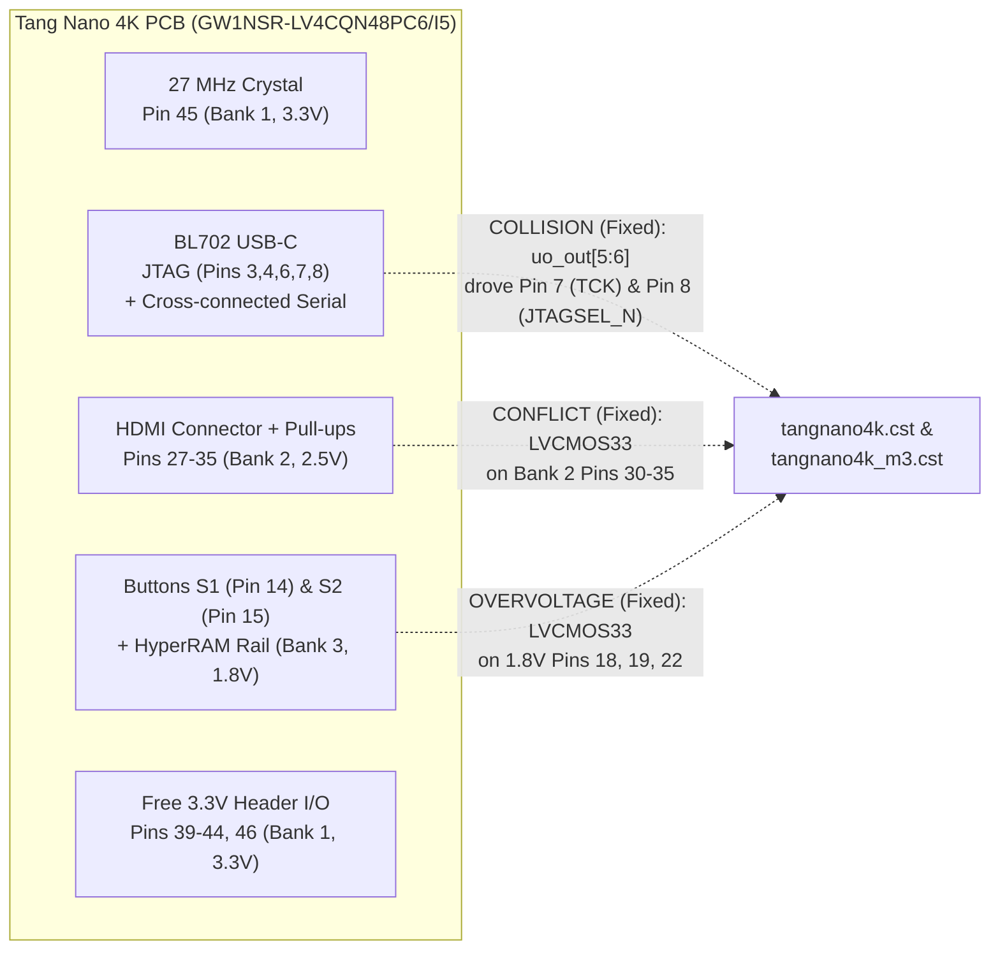

# Sipeed Tang Nano 4K Integration Audit Report

## Executive Assessment

**Verdict: Not hardware-ready.** While all 9 Gowin CI matrix jobs (`Full`, `Lite`, `Tiny`, `Ultra-Tiny`, `Tiny-Serial`, `M3-GPIO`, `M3-APB`, `M3-AHB`, `M3-AHB-DMA`) compile and pass open-source synthesis/PnR in GitHub Actions, **neither the standalone FPGA wrapper nor the Cortex-M3 SoC testbench will function safely or correctly on a physical Sipeed Tang Nano 4K (`GW1NSR-LV4CQN48PC6/I5`) board.**

> [!CAUTION]
> **Do not flash the current `.fs` bitstreams to non-volatile Flash (`openFPGALoader -f`) or connect 3.3 V external logic to Pins 13–35.**
> 1. Both `.cst` files map `uo_out[5:6]` onto **Pin 7 (`TCK`)** and **Pin 8 (`JTAGSEL_N`)**, which disables JTAG upon configuration and **soft-bricks the board** until Pin 8 is manually shorted to GND at power-on.
> 2. `tangnano4k_m3.cst` and `TANG_NANO_4K_GUIDE.md` treat **Bank 3 (Pins 13–23)** as `3.3 V` (`LVCMOS33`), whereas Bank 3 is physically powered at **`1.8 V`** on the Tang Nano 4K to supply the in-package HyperRAM, and **Bank 2 (Pins 27–35)** is wired to the HDMI TMDS connector with external pull-ups.

---

## Summary of Findings

| ID | Severity | Status | Area | Summary |
| :--- | :---: | :---: | :--- | :--- |
| **`F-TN4K-01`** | **CRITICAL** | **Fixed** | Pinout (`.cst`) | `uo_out[5:7]` and `uio[0]` collided with **JTAG (`TCK`, `JTAGSEL_N`)**, `DONE`, and onboard LED (`MODE`), soft-bricking JTAG when flashed. *Fixed in `tangnano4k.cst` and `tangnano4k_m3.cst`.* |
| **`F-TN4K-02`** | **CRITICAL** | **Fixed** | Electrical / Banks | 3.3 V `LVCMOS33` constraints were applied to **1.8 V Bank 3** (Pins 13–23) and **HDMI TMDS Bank 2** (Pins 27–35). *Fixed: Bank 3 set to `LVCMOS18`, Bank 2 to `LVCMOS25`, UART moved to 3.3 V Bank 1 (Pins 44/46).* |
| **`F-TN4K-03`** | **CRITICAL** | **Fixed** | M3 Firmware (`main.c`) | Wrong memory map & CMSDK register offsets (`UART0_BASE`, `BAUDDIV`, `GPIO0_DIR` vs `OUTENSET`/`DATAOUT`). *Fixed in `src_m3/main.c`.* |
| **`F-TN4K-04`** | **CRITICAL** | **Fixed** | M3 RTL (`tt_gowin_top_m3.v`) | `Gowin_EMPU_M3` module name and port list did not match Gowin EDA's `Gowin_EMPU_Top` IP. *Fixed: aligned to `Gowin_EMPU_Top` with AMBA APB4/AHB2 ports.* |
| **`F-TN4K-05`** | **CRITICAL** | **Fixed** | CI / Releases (`gowin.yaml`) | `M3-*` CI jobs synthesized a constant-zero stub and published empty `.fs` bitstreams. *Fixed: `Gowin_EMPU_Top` marked `(* blackbox *)`, `M3-*` runs Yosys synthesis check only.* |
| **`F-TN4K-06`** | **HIGH** | **Fixed** | SoC Memory Map | `APB_BASE_ADDR` and `AHB_BASE_ADDR` were hardcoded to `0x40020000`. *Fixed: `APB_BASE_ADDR = 0x40002400`, `AHB_BASE_ADDR = 0xA0000000`.* |
| **`F-TN4K-07`** | **HIGH** | **Fixed** | Clocking & UART | Board crystal on Pin 45 is **27 MHz** (not 20 MHz): UART baud divider `174` caused +35% error, and 27 MHz violated `Full`/`Lite` timing (~15 MHz `Fmax`). *Fixed: `UART0_BAUD = 234` in `main.c` and ÷2 clock divider (13.5 MHz) in `tt_gowin_top.v`. BL702 is assumed cross-connected to FPGA/M3 for serial.* |
| **`F-TN4K-08`** | **HIGH** | **Fixed** | M3 Flash & Tooling | `GW1NS-4C` boots Cortex-M3 from **32 KB Embedded UserFlash** (`.bin` via `--mcufw`); `bin2mi.py` had an invalid header, `link.ld` limited Flash to 16 KB, and committed `testbench.{bin,elf,mi}` were stale. *Fixed: `link.ld` updated to 32 KB + `ALIGN(4)`, `bin2mi.py` header fixed, stale binaries removed.* |
| **`F-TN4K-09`** | **MEDIUM** | **Fixed** | DMA Bridge (`ahb2_mac_bridge.v`) | `.m_hsel(m3_s_hsel_dma)` connected and dynamic cycle counts for Packed FP4 (`meta_reg[3]=1`) and Short Protocol (`meta_reg[7]=1`) implemented. |
| **`F-TN4K-10`** | **MEDIUM** | **Fixed** | Parameter Sync | `SUPPORT_DEBUG` and `SUPPORT_FLOAT32` forwarded in `tt_gowin_top.v`, `tt_gowin_top_m3.v`, `verify_rtl.py`, and `verify_rtl_m3.py`; `gowin.yaml` now uses `scripts/configure_variant.py --format=yosys`. |
| **`F-TN4K-11`** | **MEDIUM** | **Fixed** | Synchronization & Buttons | Added 2-FF synchronizers for `rst_n` and `ena` in `tt_gowin_top.v`; corrected `S1`/`S2` button labels in `TANG_NANO_4K_GUIDE.md`. |
| **`F-TN4K-12`** | **MEDIUM** | **Fixed** | Verification & Docs | Updated `TANG_NANO_4K_GUIDE.md` (Loopback Mode `ui_in = 0x50`, per-bank voltages), removed bundled ARM APB PDF, and added `ahb2_mac_bridge` functional verification test. |

---

## Tang Nano 4K Hardware Reality vs. Original Repo Mapping

---

## Detailed Findings & Proposed Fixes

### 1. Physical Constraints, Clocking & Board Electricals

#### `F-TN4K-01` [CRITICAL] — JTAG (`TCK`, `JTAGSEL_N`) and Configuration Pin Collisions
- **Locations:** [tangnano4k.cst](file:///home/antigravity/chatelao/ttihp-fp8-mul/src_gowin/tangnano4k.cst#L22-L27), [tangnano4k_m3.cst](file:///home/antigravity/chatelao/ttihp-fp8-mul/src_gowin/tangnano4k_m3.cst#L23-L28)
- **Problem:** Both constraint files assign:
  - `uo_out[5]` → **Pin 7** (`IOT3B / TCK`)
  - `uo_out[6]` → **Pin 8** (`IOT4B / JTAGSEL_N`)
  - `uo_out[7]` → **Pin 9** (`IOT5B / DONE`)
  - `uio[0]` → **Pin 10** (`IOT7A / MODE1`, wired to onboard LED) in [tangnano4k.cst](file:///home/antigravity/chatelao/ttihp-fp8-mul/src_gowin/tangnano4k.cst#L26)
  Per Gowin `UG865` / `UG292` and Sipeed's Tang Nano 4K datasheet, Pins `3, 4, 6, 7, 8` are the active JTAG port connected to the onboard BL702 programmer. Driving Pin 8 (`JTAGSEL_N`) high from `uo_out[6]` disables JTAG access to the FPGA; if written to Flash (`-f`), the board becomes unresponsive to `openFPGALoader` and Gowin Programmer unless recovered via hardware pin strapping.
- **Fix:** Remove Pins `7, 8, 9` (and avoid `3, 4, 6, 8, 9`) from all user signal mappings. In `tangnano4k_m3.cst`, either map `uo_out` only to safe diagnostic pins/LED (Pin 10) or use Bank 1/3 header pins with matching `IO_TYPE`. Note that QN48P only exposes **~22 non-HDMI, non-JTAG header I/Os** across mixed voltage banks—a full 27-pin parallel 3.3 V Tiny Tapeout header (`8 ui + 8 uo + 8 uio + clk + rst_n + ena`) **cannot physically fit on Tang Nano 4K at 3.3 V without multiplexing or level shifting**.

#### `F-TN4K-02` [CRITICAL] — 3.3 V `LVCMOS33` Assigned to 1.8 V Bank 3 & HDMI Bank 2 Conflict
- **Locations:** [tangnano4k_m3.cst](file:///home/antigravity/chatelao/ttihp-fp8-mul/src_gowin/tangnano4k_m3.cst#L7-L28), [tangnano4k.cst](file:///home/antigravity/chatelao/ttihp-fp8-mul/src_gowin/tangnano4k.cst#L8-L33), [TANG_NANO_4K_GUIDE.md](file:///home/antigravity/chatelao/ttihp-fp8-mul/src_gowin/TANG_NANO_4K_GUIDE.md#L77-L106)
- **Problem:**
  - **Bank 3 (Pins 13–23)** is wired to `1.8 V` on the Tang Nano 4K PCB to power the internal HyperRAM (`UG865`). Setting `IO_TYPE=LVCMOS33` on Pins `18`, `19`, and `22` in [tangnano4k_m3.cst](file:///home/antigravity/chatelao/ttihp-fp8-mul/src_gowin/tangnano4k_m3.cst#L7-L22) causes a `Bank VCCIO` DRC error in Gowin EDA and risks permanent overvoltage damage if a 3.3 V UART adapter or 3.3 V Raspberry Pi Pico ([TANG_NANO_4K_GUIDE.md](file:///home/antigravity/chatelao/ttihp-fp8-mul/src_gowin/TANG_NANO_4K_GUIDE.md#L149)) drives Pins 13–23.
  - **Bank 2 (Pins 27–35)** is wired to the onboard HDMI connector with TMDS pull-ups. Mapping `ui_in[0:5]` to Pins `30–35` in [tangnano4k.cst](file:///home/antigravity/chatelao/ttihp-fp8-mul/src_gowin/tangnano4k.cst#L8-L13) subjects inputs to HDMI termination/pull-up bias, which Sipeed explicitly warns against.
- **Fix:**
  - Move `uart_tx` / `uart_rx` in `tangnano4k_m3.cst` to **Bank 1 (`3.3 V`)** pins—specifically **Pin 46 (`IOT13B`)** and **Pin 44 (`IOT17B`)** with `IO_TYPE=LVCMOS33` (matching your verified `m3_uart_echo` setup).
  - Explicitly set `IO_TYPE=LVCMOS18` on all Bank 3 pins (`13–23`, including buttons on `14` and `15`) and document the 1.8 V limit prominently in `TANG_NANO_4K_GUIDE.md`.
  - For standalone MCU/Pico testing, use a **UART/SPI bridge wrapper** over 3.3 V Bank 1 pins (`39, 40, 41, 42, 43, 44, 46`) instead of 24 raw parallel pins across 1.8 V / HDMI banks.

#### `F-TN4K-07` [HIGH] — 27 MHz Crystal vs. 20 MHz Assumption, Timing Violation & Missing USB-UART
- **Locations:** [tt_gowin_top_m3.v](file:///home/antigravity/chatelao/ttihp-fp8-mul/src_gowin/tt_gowin_top_m3.v#L35), [main.c](file:///home/antigravity/chatelao/ttihp-fp8-mul/src_m3/main.c#L173), [gowin.yaml](file:///home/antigravity/chatelao/ttihp-fp8-mul/.github/workflows/gowin.yaml#L95), [TANG_NANO_M3_TESTBENCH.md](file:///home/antigravity/chatelao/ttihp-fp8-mul/src_m3/TANG_NANO_M3_TESTBENCH.md#L20-L25)
- **Problem:**
  1. Pin 45 is a **27 MHz** crystal oscillator, not 20 MHz. In [main.c](file:///home/antigravity/chatelao/ttihp-fp8-mul/src_m3/main.c#L173), `UART0_BAUD = 174` (`20 MHz / 115200`) produces **155,172 baud** at 27 MHz (+34.7% error); it must be **`234`** (`27,000,000 / 115,200 = 234.375`).
  2. In `nextpnr`, the `Full` and `Lite` variants achieve an `Fmax` of **~15.0 MHz** on `GW1NS-4` (`66.66 ns` critical path). [gowin.yaml](file:///home/antigravity/chatelao/ttihp-fp8-mul/.github/workflows/gowin.yaml#L95) passes `--freq 12` to make CI pass, but [tt_gowin_top.v](file:///home/antigravity/chatelao/ttihp-fp8-mul/src_gowin/tt_gowin_top.v#L27) routes the **27 MHz** Pin 45 clock straight into `user_project.clk` without a `PLLVR`, `CLKDIV`, or clock-enable divider—guaranteeing setup-time failure on `Full` and `Lite` in hardware.
  3. Unlike Tang Nano 9K/20K, the **BL702** on Tang Nano 4K only wires JTAG to the FPGA—there is **no** onboard USB-UART bridge to Pins 18/19.
- **Fix:** Update `UART0_BAUD` to `234` for 27 MHz; add a synchronous clock-enable prescaler (e.g., ÷2 → 13.5 MHz or ÷3 → 9 MHz) or `CLKDIV`/`PLLVR` in `tt_gowin_top.v` when driven from the 27 MHz crystal; and remove the claim that USB-C provides onboard UART on Tang Nano 4K.

---

### 2. Cortex-M3 (`EMCU`) SoC & Firmware Integration

#### `F-TN4K-03` [CRITICAL] — Fatal Peripheral Base & Register Bugs in `src_m3/main.c`
- **Location:** [main.c](file:///home/antigravity/chatelao/ttihp-fp8-mul/src_m3/main.c#L4-L94)
- **Problem:** Verified against Gowin `IPUG931` (*Gowin_EMPU(GW1NS-4C) Software Programming Reference Manual*, Tables 2-1, 4-1, and 7-1):
  1. **`UART0_BASE` (`0x40000000`) is `TIMER0`:** `UART0` is at **`0x40004000`**.
  2. **`UART0_BAUD` (`+ 0x0C`) is `INTSTATUS/INTCLEAR`:** `BAUDDIV` is at **`+ 0x10`**.
  3. **`GPIO0_DIR` (`+ 0x04`) is `DATAOUT`, not direction:** CMSDK GPIO sets output direction via write-1-to-set **`OUTENSET` (`+ 0x10`)** and clears it via write-1-to-clear **`OUTENCLR` (`+ 0x14`)**. Because `0x10` is never written, all 16 GPIO pins remain inputs (`GPIO0_OE = 0`).
  4. **Read-modify-write on `GPIO0_DATA` (`+ 0x00`) wipes `RST` and `ENA`:** Lines 66, 77, and 87 read `GPIO0_DATA` (sampled `GPIO0_I`, where `[15:8]` is tied to `8'b0` in [tt_gowin_top_m3.v](file:///home/antigravity/chatelao/ttihp-fp8-mul/src_gowin/tt_gowin_top_m3.v#L130)) instead of `GPIO0_DATAOUT` (`+ 0x04`). Every `write_ui_in()` / `write_uio_in()` / `read_mac_uo()` clears `BIT_RST` (`mac_rst_n = 0`), holding the MAC in reset!
- **Fix:** Replace register definitions in `src_m3/main.c` with the verified `GW1NS-4C` CMSDK map (`UART0_BASE = 0x40004000`, `UART0_BAUDDIV = +0x10`, `GPIO0_DATAOUT = +0x04`, `GPIO0_OUTENSET = +0x10`, `GPIO0_OUTENCLR = +0x14`), use `GPIO0_DATAOUT` for output read-modify-write, and add C drivers/CLI commands for APB, AHB, and AHB-DMA modes (currently `main.c` only implements GPIO bit-banging).

#### `F-TN4K-04` [CRITICAL] — `Gowin_EMPU_M3` Wrapper Matches Neither Gowin IP Nor `EMCU` Primitive
- **Locations:** [tt_gowin_top_m3.v](file:///home/antigravity/chatelao/ttihp-fp8-mul/src_gowin/tt_gowin_top_m3.v#L360-L412), [gowin_empu_m3_stub.v](file:///home/antigravity/chatelao/ttihp-fp8-mul/src_gowin/gowin_empu_m3_stub.v#L8-L45)
- **Problem:** If a user opens `tt_gowin_top_m3.v` in official Gowin EDA and generates the EMPU IP (`gowin_empu_gw1ns4`), synthesis will fail immediately:
  - Gowin EDA generates module **`Gowin_EMPU_Top`** with ports `sys_clk`, `reset_n`, `uart0_rxd`, `uart0_txd`, `gpio` (`inout [15:0]`), AMBA APB4 ports (`master_pclk`, `master_prst`, `master_penable`, `master_paddr[7:0]`, `master_pwrite`, `master_pwdata`, `master_psel1`, `master_prdata1`, `master_pready1`, `master_pslverr1`), and AMBA AHB ports (`master_haddr`, `master_htrans`, `master_hwrite`, `master_hsize`, `master_hwdata`, `master_hsel`, `master_hreadymux`, `master_hrdata`, `master_hreadyout`, `master_hresp`).
  - Conversely, the underlying silicon primitive **`EMCU`** (in `prim_syn.v` / Yosys `cells_xtra.v`) uses `FCLK`, `PORESETN`, `SYSRESETN`, `IOEXPOUTPUTO`, `IOEXPINPUTI`, `TARGEXP0*`, `INITEXP0*`, `APBTARGEXP2*`, and `SRAM0*`.
  - The custom `ADDR`/`DATAOUT`/`WRITE`/`READ`/`DATAIN` bus in `gen_apb_integration` ([tt_gowin_top_m3.v](file:///home/antigravity/chatelao/ttihp-fp8-mul/src_gowin/tt_gowin_top_m3.v#L48-L52)) does not exist in either interface (standard AMBA APB uses `PSEL && PENABLE && PWRITE`).
- **Fix:** Align `tt_gowin_top_m3.v` and its simulation/lint blackbox stub with Gowin EDA's actual `Gowin_EMPU_Top` port signature (using standard AMBA APB4 `PSEL`/`PENABLE`/`PWRITE`/`PREADY` and AHB `master_h*` / `slave_h*` signal names).

#### `F-TN4K-06` [HIGH] — Wrong APB2 and AHB2 Hardware Base Addresses
- **Locations:** [tt_gowin_top_m3.v](file:///home/antigravity/chatelao/ttihp-fp8-mul/src_gowin/tt_gowin_top_m3.v#L32-L33), [ahb2_mac_bridge.v](file:///home/antigravity/chatelao/ttihp-fp8-mul/src_gowin/ahb2_mac_bridge.v#L4)
- **Problem:** Both files set `APB_BASE_ADDR = 32'h40020000` and `AHB_BASE_ADDR = 32'h40020000`. In `GW1NS-4C` silicon (`IPUG931` Table 2-1):
  - **APB2 Master Slot 1** is fixed at **`0x40002400`** (with `master_psel1` already decoded by the hard bridge and an 8-bit local offset `master_paddr[7:0]`).
  - **AHB2 Master (`TARGEXP0`)** is fixed at **`0xA0000000`**. Comparing `haddr[31:8] == 24'h400200` rejects all valid `0xA00000xx` transactions from the Cortex-M3.
- **Fix:** Change `APB_BASE_ADDR` to `32'h40002400` (using `master_psel1 && master_penable` for APB selection) and `AHB_BASE_ADDR` to `32'hA0000000`.

#### `F-TN4K-08` [HIGH] — Non-Existent `.mi` Instruction Memory Flow & Stale M3 Binaries
- **Locations:** [bin2mi.py](file:///home/antigravity/chatelao/ttihp-fp8-mul/src_m3/bin2mi.py), [link.ld](file:///home/antigravity/chatelao/ttihp-fp8-mul/src_m3/link.ld#L3-L4), [TANG_NANO_M3_TESTBENCH.md](file:///home/antigravity/chatelao/ttihp-fp8-mul/src_m3/TANG_NANO_M3_TESTBENCH.md#L152-L166), `src_m3/testbench.{bin,elf,mi}`
- **Problem:**
  1. `GW1NS-4C` (`gowin_empu_gw1ns4.ipc`) has **no `.mi` Instruction Memory parameter**—the hard Cortex-M3 boots from the **32 KB Embedded UserFlash** (`0x00000000`), flashed directly with `testbench.bin` via `openFPGALoader -b tangnano4k --mcufw testbench.bin` or Gowin Programmer's *MCU Mode*.
  2. Even for Gowin IPs that do take `.mi` files, [bin2mi.py](file:///home/antigravity/chatelao/ttihp-fp8-mul/src_m3/bin2mi.py#L27-L31) writes an invalid header (`#GOWIN BINARY FILE` instead of `#File_format=Hex` / `#Address_depth=...` / `#Data_width=32`).
  3. [link.ld](file:///home/antigravity/chatelao/ttihp-fp8-mul/src_m3/link.ld#L3-L4) specifies `16K` Flash / `16K` SRAM, whereas `GW1NSR-LV4C` has `32K` UserFlash (`0x00000000`) and up to `22K`–`32K` SRAM (`0x20000000`), and lacks `ALIGN(4)` before `_edata`/`_ebss` (which can misalign the word-copy loop in `startup.c`).
  4. The committed `src_m3/testbench.bin`, `testbench.elf`, and `testbench.mi` are stale pre-built artifacts (compiled when `vectors[]` only had 2 entries—word 2 is `0x4280f04f` Thumb code instead of `NMI_Handler`).
- **Fix:** Remove `testbench.{bin,elf,mi}` (and `bin2mi.py` or fix its `#File_format=Hex` header), update `link.ld` (`FLASH LENGTH = 32K`, `ALIGN(4)` on section boundaries), add `gcc-arm-none-eabi` compilation to CI so firmware never rots, and document `openFPGALoader -b tangnano4k -f bitstream.fs --mcufw testbench.bin`.

---

### 3. CI/CD Workflows, DMA Bridge & Test Coverage

#### `F-TN4K-05` [CRITICAL] — CI Publishes Empty `tangnano4k_M3-*.fs` Bitstreams Built from Constant-Zero Stub
- **Locations:** [gowin.yaml](file:///home/antigravity/chatelao/ttihp-fp8-mul/.github/workflows/gowin.yaml#L62-L131), [gowin_empu_m3_stub.v](file:///home/antigravity/chatelao/ttihp-fp8-mul/src_gowin/gowin_empu_m3_stub.v#L48-L65)
- **Problem:** Project Apicula (`gowin_pack` / `nextpnr`) does not currently configure the `GW1NS-4C` `EMCU` hard processor tile or pack MCU UserFlash. Because `gowin_empu_m3_stub.v` drives all outputs to `0` (`GPIO0_O = 0`, `M_AHB_HSEL = 0`, `WRITE = 0`), Yosys constant-propagates `mac_rst_n = 0` and `mac_ena = 0` and **strips out the entire `tt_um_chatelao_fp8_multiplier` and `ahb2_mac_bridge` netlist** (explaining why `M3-*` PnR finishes in 32s while `Full` takes 76s!). Publishing `tangnano4k_M3-*.fs` on GitHub Releases misleads users with empty bitstreams.
- **Fix:**
  - Stop uploading `tangnano4k_M3-*.fs` as release bitstreams from Apicula unless built with Gowin EDA (`gw_sh`), **or** replace the open-source Tang Nano 4K release target with a **pure-fabric UART-to-MAC bridge** (`tt_gowin_uart_top.v`) that works 100% end-to-end with open-source Yosys + `nextpnr` + `gowin_pack` + WebSerial/Python without needing proprietary Gowin EDA IP encryption!
  - For CI syntax/resource checks of `tt_gowin_top_m3.v`, mark `Gowin_EMPU_Top` `(* blackbox *)` during Yosys synthesis check only (without running `gowin_pack` to produce fake `.fs` files), and build `src_m3/testbench.bin` with `arm-none-eabi-gcc` in CI.

#### `F-TN4K-09` [MEDIUM] — `ahb2_mac_bridge.v` Protocol Limitations & Permanent `S_AHB_HSEL`
- **Locations:** [ahb2_mac_bridge.v](file:///home/antigravity/chatelao/ttihp-fp8-mul/src_gowin/ahb2_mac_bridge.v#L47-L57), [tt_gowin_top_m3.v](file:///home/antigravity/chatelao/ttihp-fp8-mul/src_gowin/tt_gowin_top_m3.v#L290-L318)
- **Problem:**
  - `ahb2_mac_bridge.v` hardcodes a 41-cycle unpacked Standard Protocol (`CYCLE_STREAM_END = 34`, `CYCLE_READ_END = 40`). If `meta_reg` enables **Packed FP4** (`last_cycle = 24`) or **Short Protocol** (`meta_reg[7] = 1`, skipping Cycles 1–2), the DMA FSM desynchronizes from the MAC FSM.
  - [tt_gowin_top_m3.v](file:///home/antigravity/chatelao/ttihp-fp8-mul/src_gowin/tt_gowin_top_m3.v#L290) hardwires `m3_s_hsel_dma = 1'b1` while leaving `.m_hsel()` on `ahb_dma_bridge_inst` unconnected; `m_hsel` from `ahb2_mac_bridge` should drive `m3_s_hsel_dma`.
- **Fix:** Connect `.m_hsel(m3_s_hsel_dma)` and compute `stream_end` / `flush_end` / `read_end` dynamically in `ahb2_mac_bridge.v` from `meta_reg` and `scale_a_reg`/`scale_b_reg` (supporting Packed FP4 and Short Protocol).

#### `F-TN4K-10` [MEDIUM] — Missing `SUPPORT_DEBUG`/`SUPPORT_FLOAT32` Parameters & Stale `gowin.yaml` Flags
- **Locations:** [tt_gowin_top.v](file:///home/antigravity/chatelao/ttihp-fp8-mul/src_gowin/tt_gowin_top.v#L3-L63), [tt_gowin_top_m3.v](file:///home/antigravity/chatelao/ttihp-fp8-mul/src_gowin/tt_gowin_top_m3.v#L3-L435), [gowin.yaml](file:///home/antigravity/chatelao/ttihp-fp8-mul/.github/workflows/gowin.yaml#L52-L61)
- **Problem:** Neither wrapper forwards `SUPPORT_DEBUG` or `SUPPORT_FLOAT32`, forcing `Tiny`, `Ultra-Tiny`, and `Tiny-Serial` FPGA builds to synthesize the 40-bit LZC, `fixed_to_float` engine, and debug muxes. Meanwhile, `gowin.yaml` duplicates variant parameters manually with outdated values (`ACCUMULATOR_WIDTH=32` and `SUPPORT_INPUT_BUFFERING=1` on `Full`).
- **Fix:** Add `SUPPORT_DEBUG` and `SUPPORT_FLOAT32` to both wrappers (and `verify_rtl.py` / `verify_rtl_m3.py`), and replace the hardcoded `if/elif` block in `gowin.yaml` with `python3 scripts/configure_variant.py "${{ matrix.variant }}" --format=yosys`.

#### `F-TN4K-11` & `F-TN4K-12` [MEDIUM] — Missing Input Synchronizers, Zero Functional Simulation & Stale Guide
- **Locations:** [tt_gowin_top.v](file:///home/antigravity/chatelao/ttihp-fp8-mul/src_gowin/tt_gowin_top.v#L24-L30), [TANG_NANO_4K_GUIDE.md](file:///home/antigravity/chatelao/ttihp-fp8-mul/src_gowin/TANG_NANO_4K_GUIDE.md#L80-L120), [TANG_NANO_M3_TESTBENCH.md](file:///home/antigravity/chatelao/ttihp-fp8-mul/src_m3/TANG_NANO_M3_TESTBENCH.md#L105), `src_m3/IHI0024E_amba_apb_architecture_spec.pdf`
- **Problem:**
  - `rst_n` and `ena` in `tt_gowin_top.v` have no 2-FF reset-release / enable synchronizer against `clk`. Button labels in `TANG_NANO_4K_GUIDE.md` swap `S1` (Pin 14) and `S2` (Pin 15).
  - Step A of `TANG_NANO_4K_GUIDE.md` still says `ui_in[5] = 1` enters Loopback Mode (`ui_in[5]` is now `float32_mode`; Loopback Mode requires `ui_in = 0x50` i.e. `ui_in[6]=1` and `ui_in[4]=1`).
  - `src_gowin/` has only regex checks (`verify_rtl.py`, `verify_rtl_m3.py`) and zero cocotb functional tests.
  - A 516 KB ARM APB specification PDF (`IHI0024E_amba_apb_architecture_spec.pdf`) is checked into `src_m3/`.
- **Fix:** Add a cocotb testbench `test/test_gowin_m3_bridges.py` verifying GPIO, APB4, AHB-Lite, and AHB-DMA transactions against `tt_um_chatelao_fp8_multiplier` (including Packed FP4 and Short Protocol); add reset synchronization in `tt_gowin_top.v`; update `TANG_NANO_4K_GUIDE.md` / `TANG_NANO_M3_TESTBENCH.md`; and remove the bundled ARM PDF.

---

## Recommended Remediation Roadmap

1. **Phase 1 — Hardware Safety & Pinout Fix (`src_gowin/*.cst`, `tt_gowin_top.v`):**
   - Evacuate JTAG/config pins (`7, 8, 9`) immediately; move UART to 3.3 V Bank 1 (`Pin 46` TX, `Pin 44` RX); set `IO_TYPE=LVCMOS18` on all Bank 3 pins (`13–23`); add clock division (27 MHz → 13.5 MHz) and reset synchronization.
2. **Phase 2 — Pure-Fabric Open-Source UART Wrapper (Optional / Recommended for OSS Flow):**
   - Because Project Apicula (`yosys` + `nextpnr` + `gowin_pack`) cannot configure the hard Cortex-M3 `EMCU` tile, adding a lightweight **fabric UART-to-MAC bridge** (`tt_gowin_uart_top.v`, ~150 LUTs) on Pins 44/46 allows a 100% open-source CI-built `.fs` bitstream to run all 6 MAC variants at 27 MHz/13.5 MHz on real Tang Nano 4K hardware over USB-UART / WebSerial!
3. **Phase 3 — Cortex-M3 (`Gowin_EMPU_Top`) & Firmware Alignment (`tt_gowin_top_m3.v`, `ahb2_mac_bridge.v`, `src_m3/`):**
   - Align `tt_gowin_top_m3.v` with Gowin EDA's `Gowin_EMPU_Top` ports and silicon base addresses (`APB = 0x40002400`, `AHB = 0xA0000000`).
   - Fix `src_m3/main.c` (`UART0_BASE = 0x40004000`, `BAUDDIV = +0x10` = `234`, CMSDK `GPIO0_DATAOUT`/`OUTENSET`/`OUTENCLR`), add APB/AHB/DMA test modes in C, fix `link.ld` (`32K` Flash), remove stale `.bin/.elf/.mi`, and compile firmware with `arm-none-eabi-gcc` in CI.
4. **Phase 4 — CI Cleanup, Parameter Sync & Cocotb Bridge Verification (`gowin.yaml`, `test/`):**
   - Forward `SUPPORT_DEBUG` and `SUPPORT_FLOAT32`, drive `gowin.yaml` from `scripts/configure_variant.py`, stop publishing constant-propagated stub `M3-*.fs` files as release assets, and add cocotb tests for all Gowin bridge modes.
